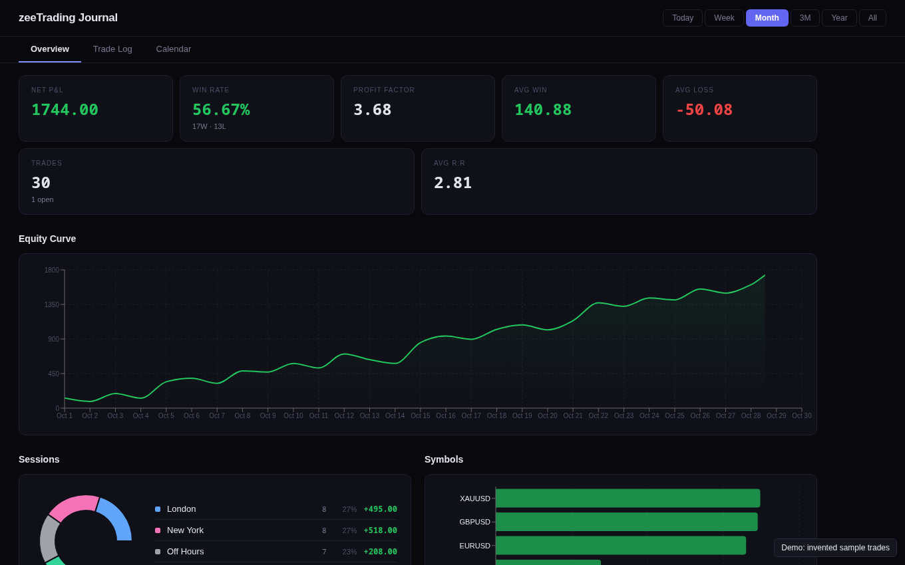
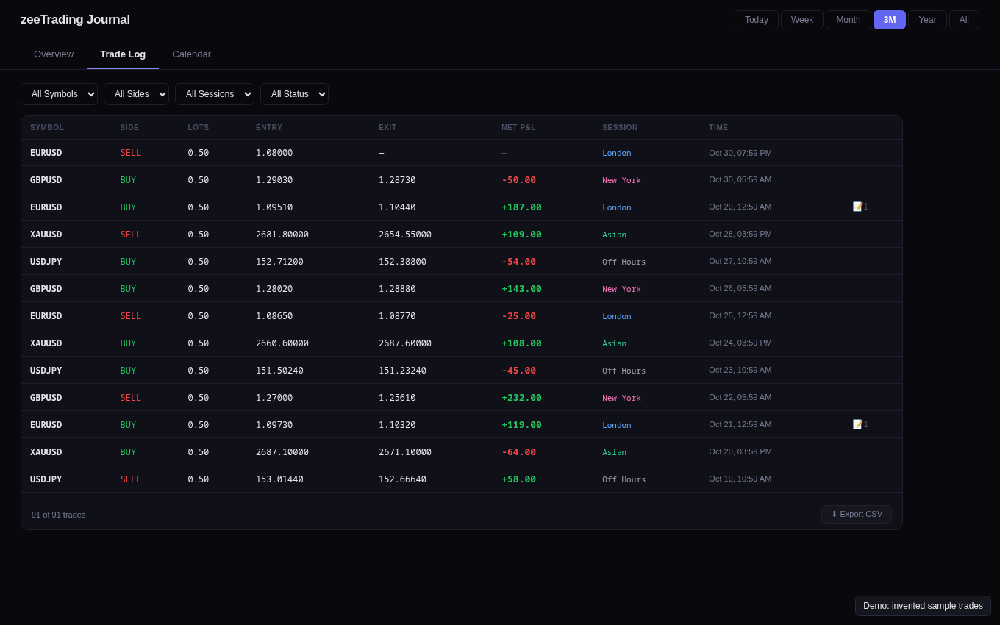
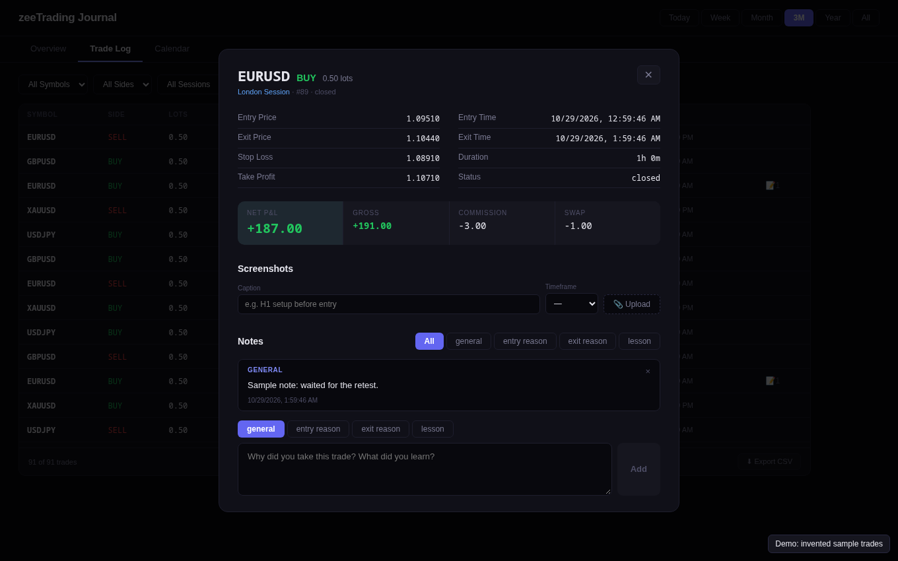

# Trading Journal Dashboard

An automatic trading journal. A background service records every cTrader trade to PostgreSQL, and a web dashboard shows how those trades performed.

**[Try the live demo](https://zmyn-ahmadi.github.io/trading-journal-dashboard/)**: it runs in your browser on invented sample trades, with no backend, and notes reset when you reload.



| Trade log | Trade detail |
| --- | --- |
|  |  |

## Features

- **Automatic recording:** connects to the cTrader Open API, backfills past trades on startup, records new ones as they happen and reconnects after a dropped connection. It's read-only and never places or changes trades.
- **Performance stats:** net P&L, win rate, profit factor, average win and loss, and an equity curve, filtered by period.
- **Breakdowns:** results by trading session and symbol, plus a calendar of daily P&L.
- **Trade log:** filter by symbol, side, session and status, then open a trade to add notes and chart screenshots.
- **Command line:** `journal_cli.py` shows the same data in a terminal.
- **Live chart display:** a relay streams market data over WebSocket to an ESP32 with a TFT screen.

## How it works

```
cTrader Open API
      │  TCP, SSL, Protobuf
      ▼
journal_daemon.py ──► PostgreSQL ◄── FastAPI (api/main.py) ◄── React dashboard
      
relay_server.py ──► WebSocket ──► ESP32 TFT display
```

More detail is in [`docs/DAEMON_DOCS.md`](docs/DAEMON_DOCS.md).

## Built with

Python, FastAPI, SQLAlchemy, PostgreSQL, Twisted, React, Vite, Recharts, and C++ on the ESP32.

## Run it locally

You need Python 3.10+, Node.js, PostgreSQL and an approved [cTrader Open API application](https://openapi.ctrader.com).

```bash
pip install -r requirements.txt
cp .env.example .env        # add your cTrader credentials and DATABASE_URL
python get_token.py         # one-time login, saves tokens.json
python journal_daemon.py    # records trades
```

In a second terminal, start the API:

```bash
uvicorn api.main:app --reload
```

In a third, start the dashboard, then open http://localhost:5173:

```bash
cd dashboard
npm install
npm run dev
```

To run the sample-data version without any of that, use `VITE_DEMO=1 npm run dev` in `dashboard/`.

## Notes

- cTrader access tokens last about 30 days. Run `python get_token.py` to refresh.
- Set `ACCOUNT_TYPE` to `live` or `demo` in `.env`.
- Run the demo data tests with `npm test` in `dashboard/`.
